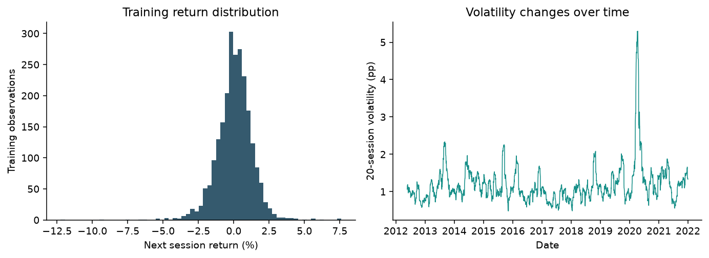
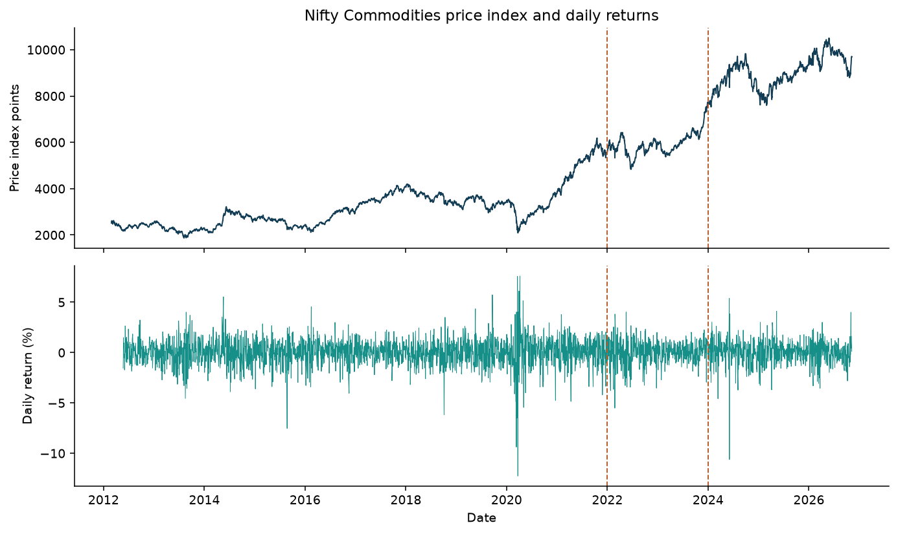
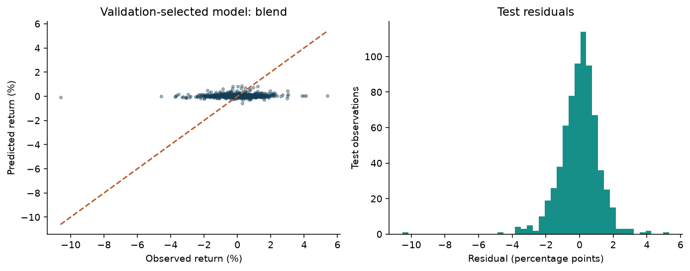
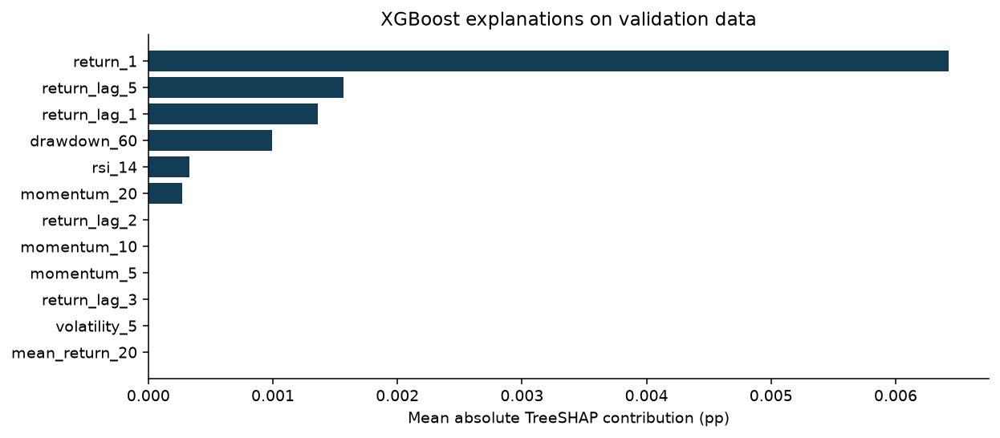

# Nifty Commodities Benchmark Return Prediction

Machine Learning with Business Data mini project

Team 12   |   Prepared 11 November 2026

| Member | SRN |
| --- | --- |
| Darshan Govekar | PES1UG24AM355 |
| Dhanraj Rathod | PES1UG24AM359 |
| Shridhar Umesh Golipalle | PES1UG25AM814 |

## Abstract

This project predicts the next observed trading session return of the Nifty Commodities price index from information available after the current close. We compare XGBoost, Keras, fastai, PyTorch TabNet and Lightning Flash using the same 23 numeric features and chronological partitions. Official NSE Indices data provide 3,644 complete OHLC observations from 27 February 2012 to 9 November 2026. Three expanding folds within the training era use separate inner stopping periods, followed by a 2022 to 2023 development validation period and a frozen test period beginning in 2024.

The lowest validation RMSE selects blend. Its test RMSE is 1.1794 percentage points, MAE is 0.8463, and R2 is 0.0021. These figures come directly from saved predictions. The comparison retains simple baselines, negative R2 values and unsuccessful complex models. A validation-selected convex blend and TreeSHAP explanations extend the course methods. The study evaluates forecast accuracy and does not claim executable trading profits.

## Project scope

The supplied Nifty Commodities brief controls this implementation. It asks for EDA, framework comparison, a report, a PowerPoint and viva preparation. The generic project list assigns a different title to ID 12. That inconsistency is recorded in the source notes and does not change the supplied topic.

# Introduction and Data

## Forecasting objective

The Nifty Commodities index represents listed Indian companies in commodity-related industries. The official October 2026 factsheet describes 30 companies. It is an equity price index, rather than a basket of physical commodity spot prices. The index launched on 7 September 2011 and has a base date of 1 January 2004. The modeling sample starts after launch. [1]

At the official close of session t, the model estimates the percentage return from that close to the close of the next observed session. The target is y(t) = 100 x [C(t+1) / C(t) - 1]. A prediction of 0.4 means a 0.4% index return. RMSE and MAE therefore use percentage points. The price series excludes reinvested dividends and must not be described as a total return benchmark.

## Official source and audit trail

The downloader submits calendar-year requests to the historical endpoint linked by NSE Indices. All 17 JSON responses are retained with request payloads, retrieval times and SHA256 checksums in data/raw/provenance.json. The frozen request ends on 10 November 2026. The latest returned session is 9 November because 10 November is an exchange trading holiday. [2]

| Quality item | Observed treatment |
| --- | --- |
| Downloaded sessions | 4,182 from 4 Jan 2010 to 9 Nov 2026 |
| Missing initial OHL | 538 sessions through 24 Feb 2012 excluded |
| Complete modeling era | 3,644 sessions from 27 Feb 2012 |
| Interior OHLC omissions | None in the retained continuous era |
| Duplicates and invalid prices | No duplicates, nonpositive prices or inconsistent OHLC retained |
| Market extremes | Preserved without winsorizing or clipping |
| Holidays and weekends | No rows fabricated and no prices filled |

Excluding a contiguous initial period avoids creating invented intraday ranges. Returns still use adjacent observed market sessions. The downloader also retains the longer close series, so the exclusion is inspectable rather than hidden.

# Exploratory Data Analysis

Training data drive exploratory interpretation. Full-history plots show context and partition boundaries, while feature correlations and distribution summaries use training observations only. The final test labels do not determine features, model settings, blend weights or model selection.

| Training target statistic | Value |
| --- | --- |
| Mean daily return | 0.0476% |
| Standard deviation | 1.2769 pp |
| Minimum and maximum | -12.2484% to 7.6024% |
| Skewness | -0.6716 |
| Excess kurtosis | 7.6595 |
| Positive return share | 53.28% |

The distribution and rolling volatility expose the scale of daily forecasting error and changes in risk. Large observed returns remain in evaluation. The rolling estimates are trailing calculations, so a future shock cannot change a past feature. A large excess kurtosis indicates tail behavior that a Gaussian error assumption would miss.

# History and Causal Features

| Feature group | Definitions available at close t |
| --- | --- |
| Short returns | Current close return and lagged returns at 1, 2, 3 and 5 sessions |
| Momentum | Close changes over 5, 10 and 20 observed sessions |
| Rolling statistics | Return mean and sample volatility over trailing 5 and 20 sessions |
| Price position | Close relative to trailing 5 and 20 session means |
| Intraday conditions | Close/open return, high-low range/close, open/previous close gap |
| Oscillator and drawdown | 14-session simple-average RSI and close relative to 60-session maximum |
| Known calendar | Sine and cosine encodings for weekday and month |

There are 23 input columns. The 60-session drawdown creates a 59-row warm-up and the final unlabeled row is removed. Features use neither centered windows nor backward filling. The exact feature order is saved in models/features.json. Correlated features can share explanatory credit, so a large attribution is not evidence of an independent economic cause.

# Methodology and Validation

| Partition | Feature dates | Rows |
| --- | --- | --- |
| train | 2012-05-22 to 2021-12-30 | 2380 |
| validation | 2022-01-03 to 2023-12-28 | 493 |
| test | 2024-01-01 to 2026-11-08 | 709 |

The training cutoff is 31 December 2021 and the development validation cutoff is 31 December 2023. Boundary purging removes a row whenever its outcome reaches the next partition first forecast date. The test starts in 2024 and remains untouched during fitting, stopping and selection. StandardScaler learns the mean and population standard deviation from training features only. Each later partition uses that same transformation. XGBoost receives the same transformed inputs for a consistent comparison, although trees do not require scaling.

## Expanding cross validation

Three expanding outer folds lie entirely inside the pre-2022 training era. Each outer score covers 252 sessions with a one-row gap. Within each fold training block, the last 126 sessions monitor early stopping and one additional row separates them from fitting. Scaling uses only the inner fitting block. The outer fold outcomes never monitor training. This follows the time-based validation requirements in Unit 1 page 81 and Unit 2 page 59. [3, 4, 5]

All five frameworks use the same fold indices, features, target, CPU setting and seed 42. Architecture settings are intentionally compact. The project does not claim an exhaustive search or identical parameter counts across different model families. Final fitting uses the full pre-2022 training block and monitors the 2022 to 2023 validation block. No post-selection refit changes the frozen test predictions.

## Metrics and selection

RMSE = sqrt(mean((y - prediction)^2)) emphasizes large errors. MAE = mean(abs(y - prediction)) measures typical absolute error. R2 = 1 - sum((y - prediction)^2) / sum((y - test mean)^2) can be negative. Direction accuracy compares whether y > 0 and prediction > 0. An exact zero prediction counts as nonpositive. This is a derived directional diagnostic, not a separately trained classifier.

The lowest development validation RMSE selects the recommendation from all models and baselines. The report displays every frozen test score for comparison. A model that happens to score best on the test is descriptive and does not replace the validation-selected recommendation.

# Framework Implementations

| Framework | Actual fitted model and settings |
| --- | --- |
| XGBoost | Squared-error boosted trees, depth 2, up to 160 trees, learning rate 0.03, subsample 0.9, column sample 0.9, L2 5, stopping patience 20. |
| Keras | Keras 3 with PyTorch backend. Dense 64 and 32 ReLU layers, dropout 0.1, L2 0.001, linear output and Adam at 0.001. |
| fastai | TabularPandas and tabular_learner. Dense 64 and 32 layers, dropout 0.1, no batch normalization, Adam at 0.001 and weight decay 0.001. |
| PyTorch TabNet | TabNetRegressor with n_d = n_a = 8, three attentive steps, gamma 1.3, sparse penalty 0.001 and Adam at 0.01. |
| Lightning Flash | A real Flash Task and Flash Trainer around a PyTorch 64 and 32 ReLU MLP, dropout 0.1 and Adam at 0.001 with weight decay 0.001. |

Deep models use at most 40 epochs and stopping patience 5. The dense models use batches of 64. TabNet uses batches of 256 with virtual batches of 64. MSE is the regression objective. Best monitored weights are restored before predictions. Model metadata save the actual stopping epoch, package versions, histories and elapsed training-plus-prediction time. [6, 7, 8, 9]

The Flash implementation uses its general Task API rather than claiming the legacy Flash TabularRegressor convenience wrapper. Flash 0.8.2 runs with PyTorch Lightning 1.9.5 and TorchMetrics 0.10.3. Its legacy checkpoint callback refers to np.Inf, so the adapter supplies a documented compatibility alias to np.inf with NumPy 2. Setuptools 80.9.0 supplies pkg_resources. These details are captured in the environment lock and code.

## Baselines and project extension

The zero-return and fixed training-mean predictors make no use of test outcomes. Ridge regression with alpha 100 provides a simple linear comparison. For the extension, validation selects tabnet among the four deep models. Eleven candidate weights from 0 to 1 combine that prediction with XGBoost. The selected XGBoost weight is 0.1. A boundary weight is retained if that is what validation selects. This project blend is not presented as a method taught in the supplied interpretability folder.

# Development Results

## Outer fold cross validation

| Model | RMSE mean and sample SD | MAE mean and sample SD |
| --- | --- | --- |
| xgboost | 1.4904 +/- 0.4456 | 1.0695 +/- 0.1934 |
| keras | 1.5106 +/- 0.4991 | 1.0775 +/- 0.2224 |
| fastai | 1.4951 +/- 0.4603 | 1.0678 +/- 0.2022 |
| tabnet | 1.5838 +/- 0.5704 | 1.1174 +/- 0.2574 |
| flash | 1.5008 +/- 0.4713 | 1.0810 +/- 0.2210 |

These three outer-fold scores measure sensitivity to historical eras. Their sample standard deviation describes variation across three periods and is not a confidence interval. The same stopping protocol precedes every outer score. Complete per-fold dates, row counts and signed R2 values are saved in results/cv_metrics.csv.

## Development validation scores

| Model | RMSE pp | MAE pp | R2 | Direction |
| --- | --- | --- | --- | --- |
| zero_return | 1.1234 | 0.8360 | -0.0038 | 46.65% |
| training_mean | 1.1214 | 0.8333 | -0.0004 | 53.35% |
| ridge | 1.1286 | 0.8449 | -0.0132 | 51.32% |
| xgboost | 1.1215 | 0.8329 | -0.0004 | 53.35% |
| keras | 1.1218 | 0.8345 | -0.0009 | 55.78% |
| fastai | 1.1144 | 0.8267 | 0.0122 | 54.56% |
| tabnet | 1.1097 | 0.8179 | 0.0204 | 55.38% |
| flash | 1.1140 | 0.8297 | 0.0129 | 53.55% |
| blend | 1.1096 | 0.8183 | 0.0207 | 55.78% |

The selection rule chooses blend, with validation RMSE 1.1096 pp. Validation also monitors early stopping and selects the blend component and weight. Its scores therefore contain selection optimism. Only the later frozen test estimates performance after those choices. The blend is a candidate in this rule and receives no guaranteed preference.

# Frozen Test Results

| Model | RMSE pp | MAE pp | R2 | Direction |
| --- | --- | --- | --- | --- |
| zero_return | 1.1813 | 0.8428 | -0.0011 | 44.29% |
| training_mean | 1.1807 | 0.8385 | -0.0001 | 55.71% |
| ridge | 1.1889 | 0.8483 | -0.0140 | 47.81% |
| xgboost | 1.1786 | 0.8379 | 0.0034 | 55.99% |
| keras | 1.1730 | 0.8491 | 0.0130 | 51.90% |
| fastai | 1.1842 | 0.8338 | -0.0061 | 54.44% |
| tabnet | 1.1804 | 0.8480 | 0.0003 | 51.06% |
| flash | 1.1762 | 0.8339 | 0.0075 | 55.15% |
| blend | 1.1794 | 0.8463 | 0.0021 | 51.48% |

The validation-selected blend records test RMSE 1.1794 pp, MAE 0.8463 pp, R2 0.0021 and direction accuracy 51.48%. The lowest observed test RMSE belongs to keras. That retrospective comparison does not change the earlier selection.

A negative R2 means that the model performs worse than predicting the mean of the evaluation outcomes in the R2 denominator. That denominator is a retrospective reference, not a deployable baseline. Compare the actual zero-return and training-mean predictors separately. Good level prediction does not imply good return prediction, so every metric here evaluates the return target.

# Interpretability and Practical Comparison

Native XGBoost TreeSHAP decomposes each prediction into a bias term and feature contributions. The computation uses only trees through the best stopping iteration. The maximum numerical additivity error is 7.45e-09 pp. On validation data, the three largest mean absolute attributions are return_1, return_lag_5, return_lag_1. These describe the fitted forecast, not causal drivers or investment value. [10]

| Framework | Simplicity | Transparency and practical efficacy |
| --- | --- | --- |
| XGBoost | Short tabular workflow | TreeSHAP and tree structure aid inspection. Compare measured errors to simple baselines. |
| Keras | Compact fit and callback API | Dense weights need attribution or sensitivity analysis. Torch backend shares the common runtime. |
| fastai | High-level tabular learner | Convenient callbacks and transforms. Dense networks remain difficult to interpret directly. |
| TabNet | More architecture settings | Attentive masks and aggregate importances add model explanations. Masks are not causal evidence. |
| Flash | Most legacy setup work here | Task and Trainer expose training steps. Compatibility pins add maintenance cost. |

Simplicity and transparency are reasoned qualitative comparisons, not invented numeric ratings. Efficacy is the observed RMSE, MAE, R2 and direction accuracy on identical dates. The simple baseline remains preferable when added complexity fails to improve the chosen validation criterion.

# Conclusion and Reproducibility

The completed comparison selects blend under the stated validation rule. Its frozen test RMSE is 1.1794 pp and R2 is 0.0021, indicating very weak predictive skill. The blend improves RMSE over zero return by only 0.001918 pp. Its direction accuracy of 51.48% falls below the training-mean benchmark at 55.71%. These results do not establish a reliable forecasting advantage. The blend and model explanations extend the analysis without using final test labels to optimize the system.

## Limitations

One index and one final test era limit generalization. Inputs contain only the index own OHLC history and known calendar values. They omit macroeconomic releases, exchange rates, commodity futures, news and fundamentals. The experiment uses one seed, so it does not estimate neural initialization uncertainty. Historical data can be revised by the provider.

The final model remains frozen at its original training cutoff, which makes evaluation auditable but can become stale. Rolling retraining and additional independent eras would be the next experiment. They must be specified before looking at new outcomes. A signal computed after the official close cannot assume execution at that same closing price. No trading return, Sharpe ratio or profit claim is made.

## Files and commands

The project includes the raw source responses and provenance, processed partitions, actual framework checkpoints, predictions, metrics, figures, an executed analysis notebook, editable presentation, report and viva guide. From a Python 3.12 environment, install requirements.txt, then run python src/pipeline.py. Run python -m unittest discover -s tests -v to verify causality, split isolation and the saved metrics. The local Windows launcher uses the prepared .venv environment.

Model caches carry a signature of the source CSV and training code. Code or data changes force new prediction caches. Downloading is a separate explicit command, so reproduction uses the frozen snapshot by default. The project is published in a private GitHub repository at https://github.com/Darshansg76/Team12-Nifty-Commodities-Return-Prediction on the main branch. Grant the instructor repository access before sharing the viva link.

## Connection to the four units

| Course material | Application |
| --- | --- |
| Unit 1 pp 81 and 145 to 163 | Time-based forecasting and regression evaluation with signed R2 |
| Unit 2 pp 7 to 8 and 47 to 59 | Train-only preprocessing, common folds and untouched final test |
| Deep Learning 1.pdf pp 6 and 25 to 33 | Two hidden layers, fair features, stopping and best checkpoints |
| Interpretability 3.pdf to 6.pdf | Local explanations, SHAP and limits of feature attribution |

# References and Source Notes

[1] NSE Indices Limited. Nifty Commodities factsheet, 30 October 2026. https://www.niftyindices.com/Factsheet/ind_nifty_commodities.pdf. Local copy retained in references.

[2] NSE Indices. Historical data and index page. https://www.niftyindices.com/reports/historical-data and https://www.niftyindices.com/indices/equity/thematic-indices/nifty-commodities. Official trading holiday calendar: https://www.nseindia.com/resources/exchange-communication-holidays. Retrieved 11 November 2026. Requests and checksums are in data/raw/provenance.json.

[3] Supplied unit 1 merged.pdf. Time-based split p 81. Regression metrics pp 145 to 163. Page references use physical PDF positions.

[4] Supplied unit 2 merged.pdf. Leakage pp 7 to 8 and 25. Common evaluation and time-series validation pp 47 and 59. Detailed mapping is in references/unit_1_2_mapping.md.

[5] Scikit-learn. TimeSeriesSplit API. https://scikit-learn.org/stable/modules/generated/sklearn.model_selection.TimeSeriesSplit.html.

[6] Chen, T. and Guestrin, C. 2016. XGBoost A Scalable Tree Boosting System. https://arxiv.org/abs/1603.02754.

[7] Keras. EarlyStopping and multi-backend configuration. https://keras.io/api/callbacks/early_stopping/ and https://keras.io/getting_started/. fastai. Tabular learner. https://docs.fast.ai/tabular.learner.html.

[8] Arik, S. O. and Pfister, T. TabNet Attentive Interpretable Tabular Learning. https://arxiv.org/abs/1908.07442. Implementation: https://github.com/dreamquark-ai/tabnet.

[9] Lightning Flash. Task API. https://lightning-flash.readthedocs.io/en/stable/api/generated/flash.core.model.Task.html. Supplied Deep_Learning_with_Tabular_Business_Data/1.pdf and 3.pdf. Page mapping in references/unit_3_4_mapping.md.

[10] Lundberg, S. and Lee, S. I. 2017. A Unified Approach to Interpreting Model Predictions. https://arxiv.org/abs/1705.07874. Native contributions: https://xgboost.readthedocs.io/en/stable/python/python_api.html.

## Resolution of source inconsistencies

The specific project brief names Nifty Commodities, while the generic list assigns investor risk tolerance to Project ID 12. This submission follows the specific brief and the user topic. The team PDF supplies the full names and SRNs. The user clarified that the old prohibition on AI assistance no longer applies. No claim of unaided authorship is made.

Unit 1 examples constrain or take the absolute value of R2, which is unsuitable for held-out evaluation. This implementation preserves signed R2. The supplied SHAP lecture cites arXiv 1602.04938, which is the LIME paper. This report cites the original SHAP paper instead. The interpretability folder name mentions blending, but its PDFs do not develop the blend used here.
